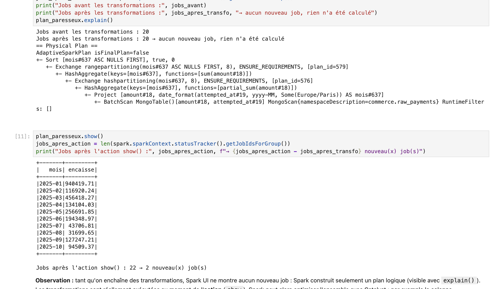
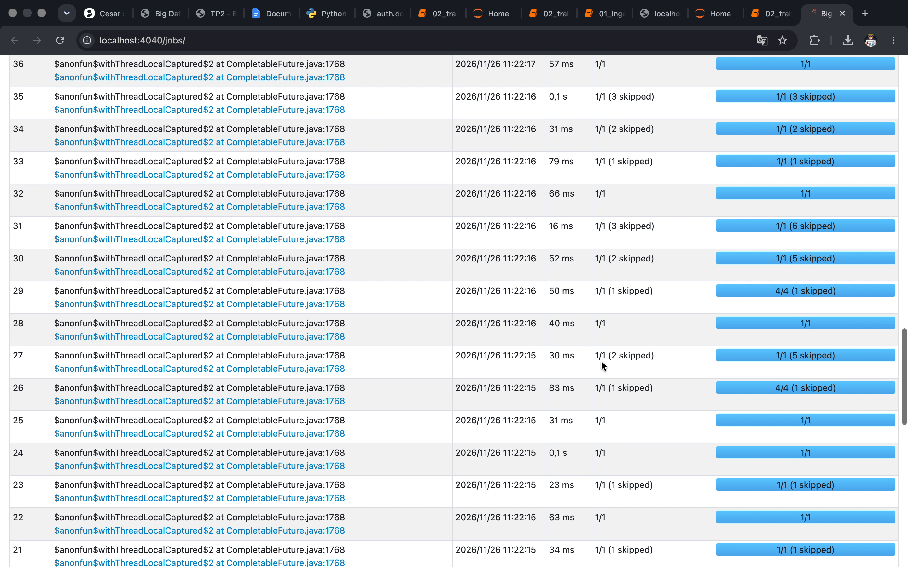
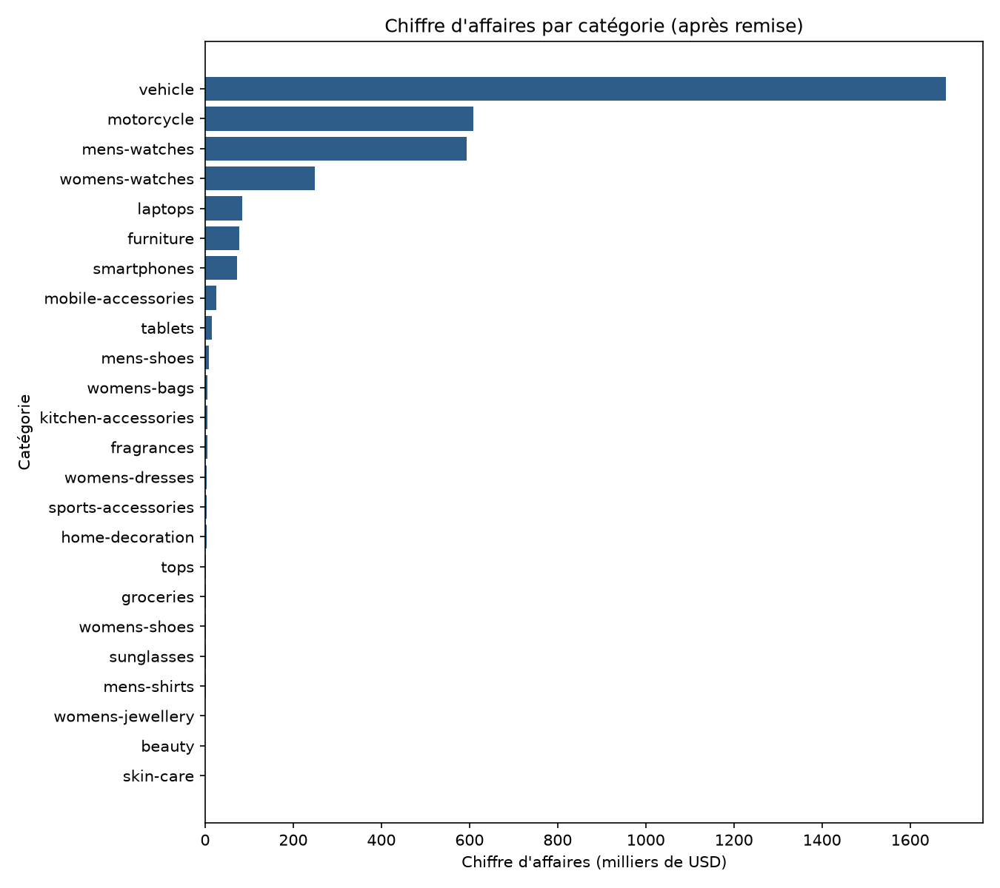
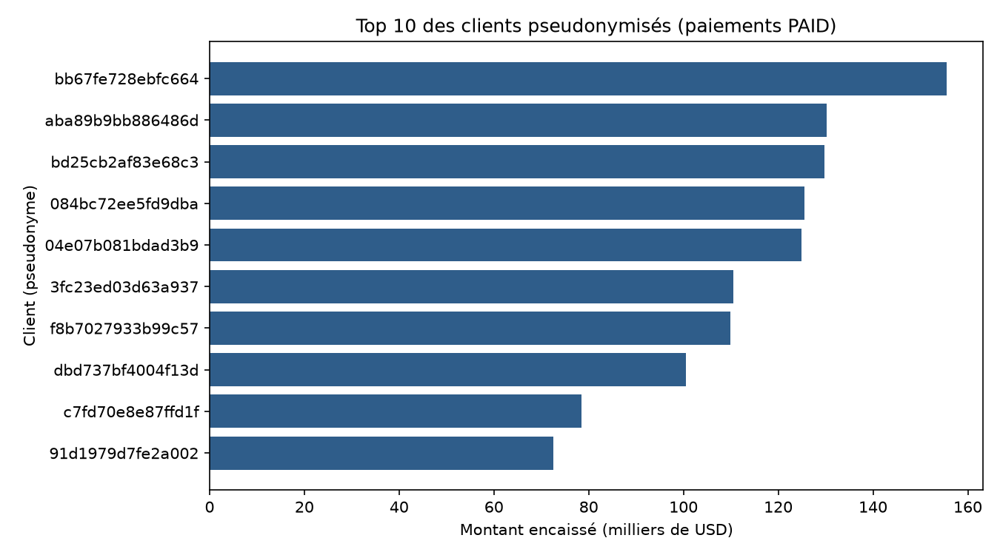
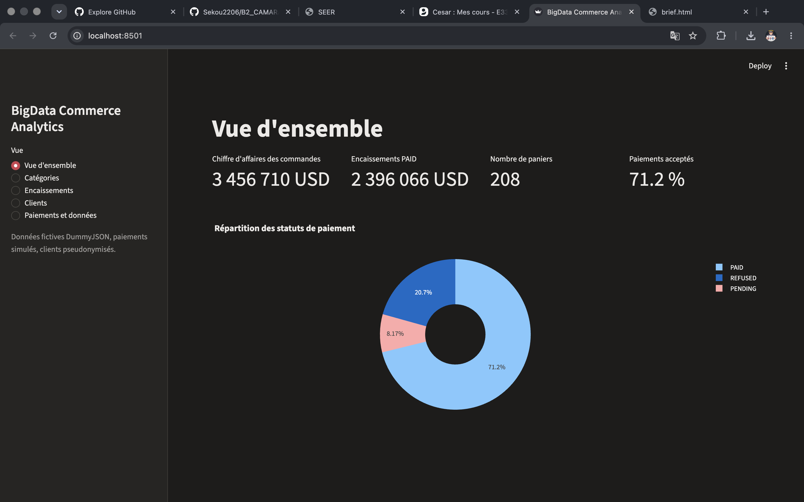

# Big Data Commerce Analytics

Sekou Camara, B2 Sup de Vinci Rennes, novembre 2026

Projet fil rouge du cours Big Data. On part des données de démonstration de l'API DummyJSON, on les range dans MongoDB, puis on les traite avec PySpark pour sortir des indicateurs de vente.

## Contenu du dépôt

| Dossier ou fichier | Ce qu'il contient |
| --- | --- |
| `TP1_BigData_Commerce_Analytics.pdf` | Les réponses du TP1 : fiche des sources, profilage, cadrage des 5V |
| `TP1/scripts/01_collecte_dummyjson.py` | Le script qui télécharge les 8 ressources de l'API |
| `TP1/notebooks/01_atelier_exploration_sources.ipynb` | Atelier 1 : exploration des sources |
| `TP1/notebooks/02_atelier_profilage_pandas.ipynb` | Atelier 2 : profilage du fichier des commandes |
| `TP1/data/` | Les données brutes (JSON) et le fichier des commandes |
| `TP2/01_ingestion_api_mongodb.ipynb` | Chargement dans MongoDB et simulation des paiements |
| `TP2/02_traitement_pyspark.ipynb` | Traitement avec PySpark, Spark UI et indicateurs |
| `TP2/resultats/` | Les indicateurs en CSV, pour le jour 3 |
| `TP3/atelier_jour3.ipynb` | Pseudonymisation des clients, export Parquet et 3 graphiques |
| `TP3/app.py` | Le dashboard Streamlit |
| `TP3/data/` | Les datasets Parquet pseudonymisés |
| `TP3/graphiques/` | Les 3 graphiques exportés |
| `TP3/architecture.md` | Le schéma du pipeline et le rôle de chaque outil |
| `TP3/note_securite.md` | Les données personnelles, les risques et les protections |
| `captures/` | Les captures de Spark UI et des notebooks |

## Outils utilisés

Python 3.12, pandas, Jupyter, MongoDB 7 dans Docker, Java 17, PySpark 4.0.1 avec le connecteur MongoDB 11.0.0, Matplotlib, Streamlit, Plotly et Parquet.

## Lancer le projet

```bash
python3.12 -m venv .venv
source .venv/bin/activate
pip install pymongo pandas jupyter requests matplotlib pyspark==4.0.1 streamlit plotly pyarrow
docker run -d -p 27017:27017 --name mongo mongo:7
python TP1/scripts/01_collecte_dummyjson.py
jupyter notebook
```

Ensuite on ouvre les notebooks dans l'ordre : TP1 puis TP2.

Pour le TP3, la clé secrète se met dans le terminal avant de lancer Jupyter (elle n'est pas dans le dépôt) :

```bash
export PSEUDO_KEY="votre cle secrete"
jupyter notebook
cd TP3 && streamlit run app.py
```

## Résultats principaux

| Indicateur | Résultat |
| --- | --- |
| Lignes de commande | 800 lignes, 208 paniers, 24 catégories |
| Paiements simulés | 148 PAID, 43 REFUSED, 17 PENDING |
| Montant encaissé | 2 396 066,11 USD sur 3 456 709,58 USD tentés (69,3 %) |
| Taux de refus | 20,7 % |
| Catégories en tête | véhicules, motos, montres homme (83,4 % du CA) |
| Top 10 clients | 47,5 % de l'argent encaissé |

Toutes les données sont fictives (DummyJSON) et les paiements sont simulés.

## Spark UI

Lazy evaluation : le nombre de jobs reste à 20 après les transformations et passe à 22 après l'action `show()`.



Après `repartition(4)`, Spark lance 4 tasks, une par partition.



## TP3 : graphiques





## TP3 : dashboard Streamlit

Le dashboard a 5 vues. On le lance avec `cd TP3 && streamlit run app.py`.



| Vue | Capture |
| --- | --- |
| Catégories | [voir](captures/tp3_dashboard_2_categories.png) |
| Encaissements | [voir](captures/tp3_dashboard_3_encaissements.png) |
| Clients | [voir](captures/tp3_dashboard_4_clients.png) |
| Paiements et données | [voir](captures/tp3_dashboard_5_paiements.png) |

Le schéma complet est dans [TP3/architecture.md](TP3/architecture.md) et la note de sécurité dans [TP3/note_securite.md](TP3/note_securite.md).
