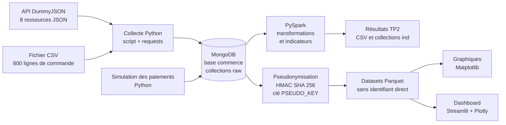

# Architecture de la solution

## Schéma du pipeline

## Rôle de chaque composant

| Étape | Outil | Rôle | Pourquoi ce choix |
| --- | --- | --- | --- |
| Sources | API DummyJSON, CSV | Donner les produits, paniers, utilisateurs et lignes de commande | API gratuite et publique, pratique pour apprendre |
| Collecte | Python avec requests et pandas | Télécharger les données et les mettre en forme | Simple, un seul langage pour tout le projet |
| Stockage | MongoDB dans Docker | Garder les données brutes telles qu'elles arrivent | Stocke directement du JSON, même si les documents n'ont pas tous les mêmes champs |
| Simulation | Python et numpy | Créer un paiement par panier (PAID, REFUSED, PENDING) | DummyJSON n'a pas de paiements |
| Traitement | PySpark 4.0.1 | Filtrer, regrouper et calculer les indicateurs | Fait pour les gros volumes : le même code marcherait sur un cluster |
| Sécurité | HMAC SHA 256 | Remplacer les identifiants clients par des pseudonymes | Même client donne toujours le même pseudonyme, impossible à retrouver sans la clé |
| Datasets analytiques | Parquet | Fichiers prêts pour l'analyse, sans identifiant direct | Format compressé, en colonnes, rapide à lire |
| Visualisation | Matplotlib, Streamlit, Plotly | Graphiques et tableau de bord interactif | Tout reste en Python, Streamlit fait une appli web en quelques lignes |

## Le pipeline en 6 étapes

1. **Collecte** : le script télécharge les 8 ressources de l'API et construit le fichier des commandes.
2. **Stockage** : les données sont rangées dans MongoDB, base `commerce`, collections `raw_*`. On simule aussi les paiements dans `raw_payments`.
3. **Traitement** : Spark lit MongoDB et calcule le chiffre d'affaires par catégorie, le top 10 clients, le taux de refus et l'évolution mensuelle.
4. **Sécurisation** : `user_id` et `cart_id` sont remplacés par des pseudonymes HMAC. Les identifiants directs sont retirés.
5. **Analyse** : les données pseudonymisées sont exportées en Parquet et vérifiées avec les chiffres du TP2.
6. **Visualisation** : trois graphiques Matplotlib et un dashboard Streamlit avec 5 vues.
